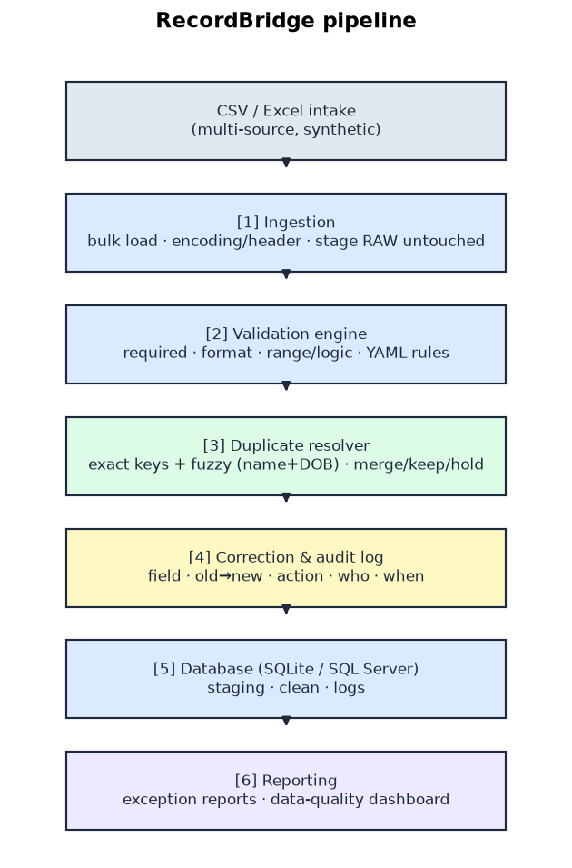
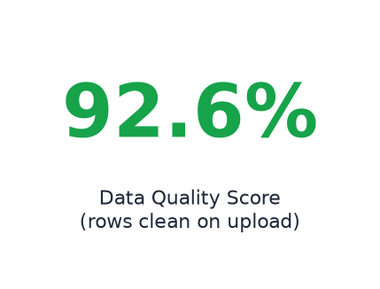
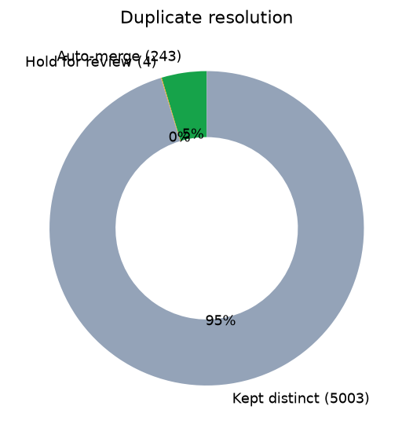
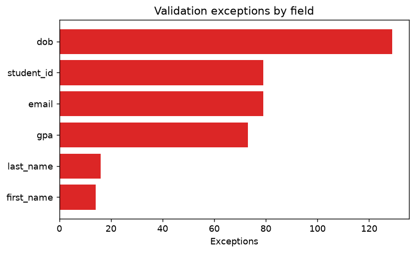
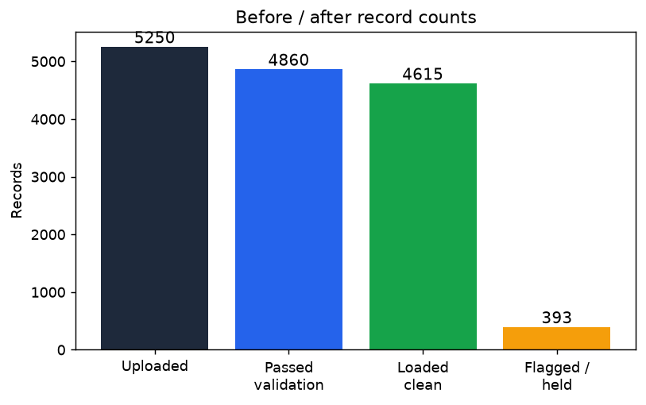
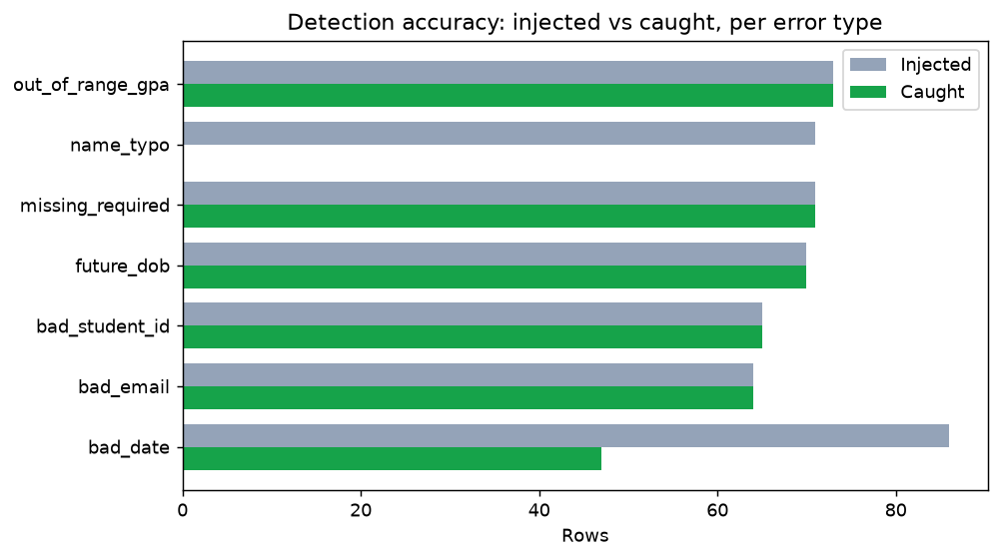
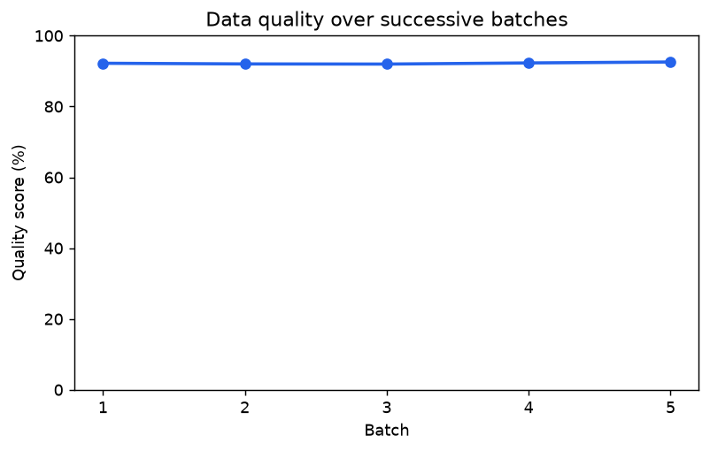

# RecordBridge

**A config-driven student-records data-integrity & governance pipeline** — it
bulk-ingests messy, multi-source student data, validates and de-duplicates it with
a **full audit trail**, loads the clean result into a database, and reports data
quality on a dashboard. Runs entirely on **synthetic data with zero PII**.

> *RecordBridge is the bridge every student record must cross between messy,
> multi-source intake and the clean, trusted Student Information System on the
> other side. Nothing passes without being validated, de-duplicated, and logged.*

**Author:** Krishita Sanjay Choksi · **License:** MIT · **Data:** synthetic only


---

## Why it exists

University admissions and registrar offices receive student data from many sources
at once — application portals, testing-agency CSVs, transcript feeds, manual staff
entry — and it arrives messy. The same student appears twice with slightly
different names. Dates come in three formats. Required fields are blank. GPAs
exceed 4.0. Before any of it can enter the official Student Information System, a
human has to clean it, validate it, resolve duplicates, and **log every correction
for audit and compliance**.

That unglamorous, high-stakes **data-operations** work is what institutions
actually pay for — and it is exactly the governance-focused data engineering that
analysis-only portfolios almost never show. RecordBridge automates it end to end.

### What makes it different

- **Data operations, not just analysis** — bulk processing, validation, duplicate
  resolution, corrections, and reporting: the steward's job, not the analyst's.
- **Fuzzy duplicate matching as a reusable component** — matching on name + DOB
  *similarity* (not just exact keys), the same engine that serves admissions, CRM,
  or healthcare master-data management.
- **Config-driven validation = a tool, not a one-off** — rules live in
  [`config/rules.yaml`](config/rules.yaml); point RecordBridge at your own CSV and
  define your own rules without touching the code.
- **Full audit logging = real governance** — every correction is recorded with
  before/after values and provenance (FERPA-style data-stewardship thinking).
- **Synthetic & reproducible** — Faker generates clean records, a *dirtifier*
  injects **labelled** errors, and because the ground truth is known the pipeline's
  accuracy is **measurable** (precision/recall), not just asserted.

---

## Architecture



```
 CSV / Excel intake (synthetic, multi-source)
        │
        ▼
 [1] Ingestion      bulk load · encoding/header detect · stage RAW untouched
 [2] Validation     required · format (email/phone/date/ID) · range/logic · YAML rules
 [3] Dedupe         exact keys + fuzzy (name+DOB) · auto-merge / keep / hold
 [4] Audit log      every change: field · old→new · action · who · when
 [5] Database       SQLite (SQL Server-ready) · staging · clean · logs
 [6] Reporting      exception reports · data-quality dashboard
```

---

## Results (seed 42, 5,000 records, ~15% injected errors)

Reproduce with `make all`. Numbers below are produced entirely by the code and
measured against the dirtifier's ground truth.

| Metric | Value |
|---|---|
| **Data quality score** (rows clean on upload) | **92.6%** |
| Validation detection — precision / recall | **1.00 / 0.78** |
| Duplicate matching — precision / recall / F1 | **0.96 / 0.95 / 0.95** |
| **Auto-merge precision** (the trust metric) | **0.975** |
| Records loaded clean | 4,618 of 5,250 |
| Borderline pairs held for review (never auto-merged) | 4 |

<table>
<tr>
<td></td>
<td></td>
</tr>
<tr>
<td></td>
<td></td>
</tr>
<tr>
<td></td>
<td></td>
</tr>
</table>

**Reading the numbers honestly:** validation has **zero false positives** (it never
flags a clean row). Its recall is 0.78 because two injected error classes are not
validation violations by design — **name typos** are a *deduplication* concern, not
a format error, and some **non-ISO dates** are **auto-corrected** by the pipeline
(and logged) rather than rejected. The duplicate resolver catches 95% of injected
duplicates, and of everything it chooses to **auto-merge, 97.5% are genuine** —
borderline pairs are routed to human review, never silently merged.

---

## Validation rules (the config, made visible)

Rules are data, not code — edit [`config/rules.yaml`](config/rules.yaml):

| Field | Check | Severity | Example violation |
|---|---|---|---|
| student_id | required + regex `^S\d{7}$` | error | `XYZ`, blank |
| first_name / last_name | required | error | blank |
| dob | date · not future · year ≥ 1950 | error | `2999-01-01`, `not a date` |
| email | required + format | error | `ada_at_example.edu` |
| phone | ≥ 10 digits | warning | `12` |
| program | required | warning | blank |
| gpa | range 0.0–4.0 | error | `5.2`, `-1.0` |

---

## Database schema

| Table | Purpose | Key columns |
|---|---|---|
| `students_staging` | Raw uploaded data, **untouched** | upload_id, raw_row, source_file, uploaded_at |
| `students_clean` | Validated, de-duplicated final records | student_id (PK), first_name, last_name, dob, email, phone, program, gpa, status, stage_id |
| `validation_errors` | Every failed check | error_id, upload_id, student_ref, field, rule_violated, severity, detected_at |
| `duplicate_pairs` | Matched duplicate candidates | pair_id, record_a, record_b, match_type, similarity_score, resolution |
| `correction_log` | Full audit trail | log_id, student_ref, field, old_value, new_value, action, changed_by, changed_at |
| `upload_batches` | Each bulk upload run | upload_id, file_name, total_rows, passed, failed, duplicates_found, run_at |

Every value in `students_clean` is traceable back through `correction_log` to its
untouched `students_staging` row — the auditability guarantee, enforced by a test.

---

## Sample exception report

```
# RecordBridge Exception Report
- Total exceptions: 390 (390 errors, 0 warnings)
- Distinct rows affected: 390

| field      | severity | count |
|------------|----------|-------|
| dob        | error    |  129  |
| email      | error    |   79  |
| student_id | error    |   79  |
| gpa        | error    |   73  |
| last_name  | error    |   16  |
| first_name | error    |   14  |
```

Full examples are regenerated into [`reports/`](reports/) by `make report`.

## Audit-trail excerpt (`correction_log`)

| student_ref | field | old_value | new_value | action | changed_by |
|---|---|---|---|---|---|
| 1423 | email | `ADA.LOVELACE@X.EDU` | `ada.lovelace@x.edu` | normalize | recordbridge |
| 882  | dob   | `03/14/2001` | `2001-03-14` | normalize | recordbridge |
| 3310 | —     | pair with 771 (fuzzy, 94.4) | auto-merge | merge | recordbridge |
| 2056 | gpa   | `range: above maximum 4.0` | — | validate | recordbridge |

---

## Install

Prerequisites: Python 3.10+.

```bash
git clone https://github.com/Krishita17/record-bridge.git
cd record-bridge
python -m venv .venv
source .venv/bin/activate      # Windows: .venv\Scripts\activate
pip install -e .
```

## Usage

Run the whole thing end to end (data → run → evaluate → report → figures →
dashboard):

```bash
make all
```

Or step by step — each is a copy-paste command:

```bash
make data        # generate synthetic clean + dirty data (+ ground truth)
make run         # ingest -> validate -> dedupe -> correct/audit -> load
make evaluate    # precision/recall vs ground truth -> results/metrics.json
make report      # exception report + audit excerpt -> reports/
make figures     # regenerate all README figures -> figures/
make dashboard   # interactive Plotly dashboard -> dashboard/*.html
make test        # run the test suite
```

### Point it at your own data

No code changes needed — bring a CSV and a rules file:

```bash
recordbridge run --input path/to/your.csv --config path/to/your_rules.yaml
```

The validation engine, exact keys, and fuzzy-matching fields are all defined in the
YAML. See [`config/rules.yaml`](config/rules.yaml) for the schema and
[`experiments/README.md`](experiments/README.md) for threshold tuning.

---

## Evaluation plan

- **Detection accuracy** — precision/recall per error type vs the labelled ground
  truth (`results/metrics.json`).
- **Duplicate-matching accuracy** — precision/recall of the fuzzy resolver, plus
  the effect of the similarity threshold (tunable in config).
- **False-positive / auto-merge precision** — how many *clean* rows get wrongly
  merged; the metric that decides whether staff would trust auto-merge (0.975 here).
- **Auditability check** — every `students_clean` row traces to a staging row
  (enforced by `tests/test_audit_and_pipeline.py`).
- **Config generality** — a second, differently-shaped CSV runs with a new rules
  file and no code changes (also a test).
- **Throughput** — a 5,000-row batch processes end to end in a couple of seconds.

## Reproducibility

Everything is seeded. The headline run is `--seed 42 --n 5000 --error-rate 0.15`.
See [`experiments/README.md`](experiments/README.md).

---

## Data ethics (read [`docs/data_ethics.md`](docs/data_ethics.md))

RecordBridge **never uses real student data**. It ships Faker-generated records and
the dirtifier; any external realism is **aggregate statistics only**, never real
individuals. The audit log and corrections model **FERPA-style** data-stewardship
thinking: traceability, no silent edits, nothing silently dropped. Fuzzy matching
makes mistakes, so borderline pairs are **held for human review, never silently
merged**.

**Responsible use:** this tool is demonstrated on synthetic data. Using it on real
student records requires appropriate authorization, security controls, and
compliance review.

## Repository layout

```
record-bridge/
├── config/rules.yaml          # validation rules (editable, no code changes)
├── src/recordbridge/
│   ├── data/                  # Faker generator + dirtifier (ground-truth labels)
│   ├── ingest/                # bulk CSV/Excel load, encoding/header detect, staging
│   ├── validate/              # config-driven validation engine
│   ├── dedupe/                # exact + fuzzy resolver, resolution routing
│   ├── audit/                 # correction + audit logging
│   ├── db/                    # schema, SQLite loader (SQL Server-ready)
│   ├── report/                # exception reports + figures + dashboard
│   ├── evaluate.py            # accuracy vs ground truth
│   └── pipeline.py            # end-to-end orchestration
├── tests/                     # validation, dedupe, audit, config-generality
├── figures/ reports/ results/ dashboard/ experiments/ docs/
└── .github/workflows/ci.yml
```

## License

MIT © 2026 Krishita Sanjay Choksi — see [LICENSE](LICENSE).
